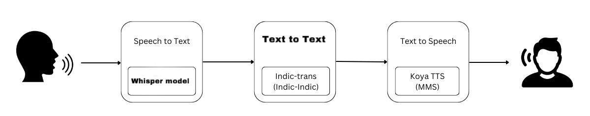
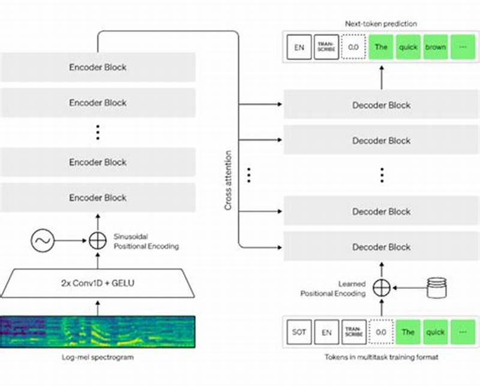
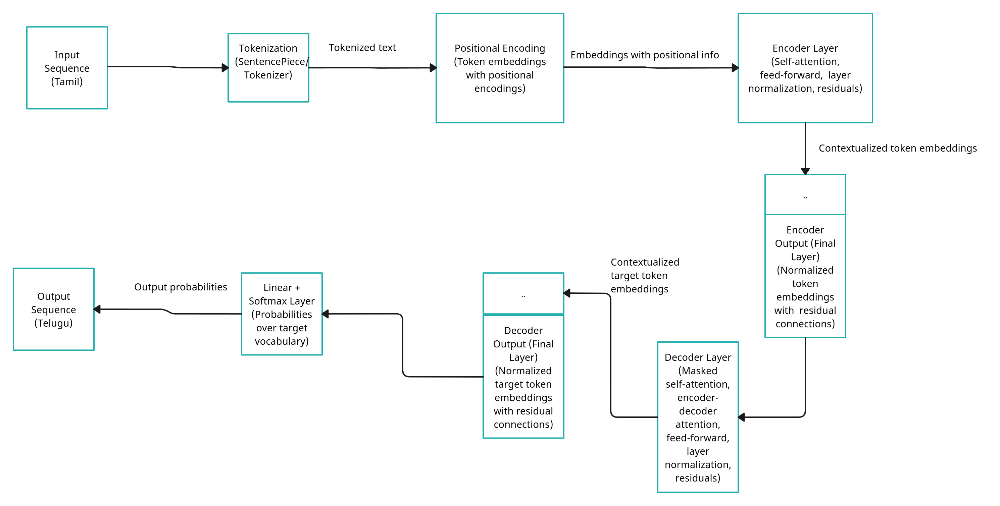
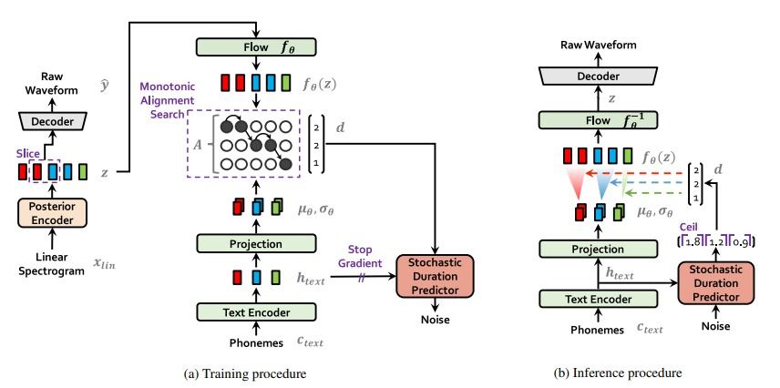

# Tamil-to-Telugu Speech-to-Speech Translation

**Whisper Tamil ASR · IndicTrans2 text translation · VITS/MMS speech synthesis**

A historical prototype chaining Tamil speech recognition, Tamil-to-Telugu text translation, and Telugu speech synthesis. This repository consolidates the existing translation project and the recovered semester notebook.

*Archived coursework prototype · Not actively maintained*

## Pipeline

| Speech recognition | Text translation | Speech synthesis |
| --- | --- | --- |
|  |  |  |

These diagrams are retained project artifacts, not newly generated experiment results.

## Implementation and recovered material

- [Speech_Processinng.ipynb](Speech_Processinng.ipynb): the existing pipeline notebook.
- [T to T.ipynb](T%20to%20T.ipynb): the existing text-translation experiment.
- [whisper_fine_tuning.ipynb](whisper_fine_tuning.ipynb): the existing ASR notebook.
- [Recovered semester notebook](semester-material/speech-translation.ipynb): an additional archived pipeline version, kept separate to preserve differences.
- [Semester source notes](semester-material/README.md): model choices, missing artifacts, and report/notebook differences.

## Historical reported results

| Measure | Value recorded in the earlier project README |
| --- | ---: |
| BLEU | 0.57 |
| Cosine similarity | 0.69597 |
| MOS | 4.43 |

The earlier README reports these values but does not establish evaluation data, BLEU scaling, the human-rating protocol, or reproducible evaluation logs. They are retained as historical claims, not independently verified measurements. No numeric WER is available in that summary.

## Explore the notebooks

Review package installation cells, input audio/text paths, model access, translation direction, and the selected speech-synthesis language before running. Configure access tokens outside source files. Model downloads, training data, and checkpoints are not redistributed by this consolidation.

The recovered report discusses a Wav2Vec recognition variant, while the semester pipeline notebook uses a Whisper Tamil model. These are documented variants; a matching end-to-end evaluation was not reproduced during preparation.

Team names and student identifiers are omitted from the showcase. Upstream model and package terms continue to apply.
