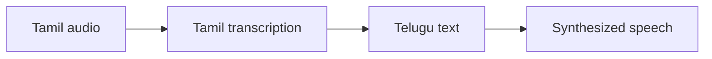

# Tamil-to-Telugu Speech Translation

### An ASR → translation → speech-synthesis prototype.

**Python · Whisper Tamil · IndicTrans2 · VITS**

*Archived coursework / research prototype · Not actively maintained*

A notebook-based prototype that chains Tamil speech recognition, Indic-language text translation, and speech synthesis. The accompanying recovered report describes Tamil-to-Telugu speech communication.

## What is included

- Tamil transcription using a Whisper model
- IndicTrans2 text translation setup
- Text-to-speech model integration
- Recovered report-method summary

The repository includes 1 directly browsable source/notebook file and a [source archive](source.zip) containing 1 file with their package structure preserved. See [SOURCE_INDEX.md](SOURCE_INDEX.md) for its contents. Reference components retain their labels and upstream notices.

## Workflow

*Diagram reconstructed from the recovered source or project description.*

## Explore / run

Open `speech-translation.ipynb` in a compatible notebook environment. Install the imported packages, configure model access and audio input paths, and inspect the selected translation direction and speech-synthesis model before use.

### Direct source files

- [speech-translation.ipynb](speech-translation.ipynb)

## Project status

No standalone translated-audio result was recovered in this folder. The report and notebook are archived artifacts; end-to-end execution has not been reproduced. The report discusses Wav2Vec-based recognition, while the retained notebook uses a Whisper Tamil model; the two should be treated as documented variants.

No training, benchmark, paid API request, or external service deployment was performed to prepare this showcase. Team names, student IDs, raw personal documents, and embedded credentials are excluded from the public upload copies. Additional scope notes are in [SOURCE_NOTES.md](SOURCE_NOTES.md).
